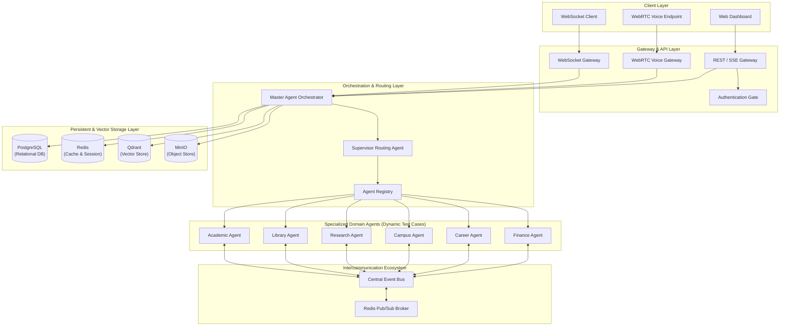
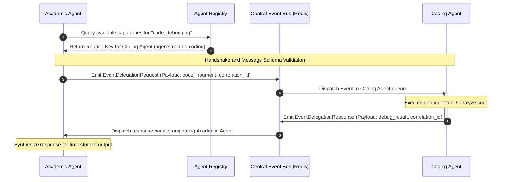
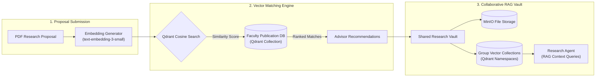

# Daffodil Intelligence (DI) — Architectural Specification
*High-Level Technical Design and Component Topology*

---

## 1. Executive Summary
**Daffodil Intelligence (DI)** is a 360° Multi-Agent Artificial Intelligence Operating System designed for academic institutions. DI centralizes academic, administrative, library, event, career, and research workflows into a single interface. 

Rather than relying on static, single-agent architectures, Daffodil Intelligence employs a dynamic orchestrator model. This orchestrator dynamically compiles task goals, delegates processes across a mesh of specialized sub-agents, and interfaces with university databases and real-time communication channels (WebSockets, WebRTC voice endpoints).

This document outlines the system architecture, component topologies, and formal designs of the platform's core extensions:
1. **The Intercommunication Ecosystem (Agent-to-Agent Event Bus)**
2. **The Research Community & Publication Hub**
3. **The Dynamic Agent Spawning & Skill Hub System**

---

## 2. System Architecture & Component Topology
Daffodil Intelligence utilizes a decoupled, multi-tier system architecture designed for high availability, secure data isolation, and real-time agent synchronization.

### Component Tiers Description
1. **Client Layer**: A modern dashboard containing real-time conversation portals, dynamic agent-status feeds, installable skill interfaces, and WebRTC-based voice calls.
2. **Gateway & API Layer**: The network access point managing session state, authentication checks, Server-Sent Events (SSE), and bidirectional WebSockets.
3. **Orchestration & Routing Layer**: The cognitive engine of DI. It parses user intent, creates step-by-step execution plans, and routes subtasks to targeted agents.
4. **Specialized Domain Agents**: Ready-made agent profiles acting as modular test cases. They represent target domain capabilities (e.g., Library search, Academic audits) that can be activated on demand.
5. **Intercommunication Ecosystem**: An event-driven message bus enabling dynamic, non-blocking agent-to-agent collaboration.
6. **Storage Layer**: A hybrid database system incorporating relational tables for session history, Redis memory caches, Qdrant vector databases for semantic search (RAG), and MinIO object storage for media attachments.

---

## 3. Core Subfeature: Intercommunication Ecosystem
The **Intercommunication Ecosystem** defines an asynchronous agent-to-agent (A2A) message-passing framework. This enables independent agents to negotiate, share insights, and delegate subtasks dynamically without manual user intervention.

### 3.1 Architectural Specifications
- **Central Event Bus**: Powered by a memory broker. Sub-queues are established dynamically for each sub-agent as they are spawned, routing inbound and outbound event messages.
- **Agent Registry**: Active agents advertise their state (`idle`, `thinking`, `executing`), tool capabilities, and communication keys.
- **Dynamic Event Routing**: When an agent determines a subtask exceeds its domain skills, it issues a delegation request to the event bus. The registry matches and routes the request to a qualified agent.
- **Agent-to-Agent Hub**: A centralized routing system managing direct message brokers, handling handshake protocols, and monitoring message queues to prevent timeouts.

### 3.2 Protocol & Schema Specifications
To ensure structural integrity across dynamic connections, all agent communication conforms to a strict, non-programmer structural specification:

| Message Property | Type | Description | Example |
|---|---|---|---|
| **Identifier (ID)** | UUID | Unique identifier for the transaction event. | `f870d19e-f2ff-4ce9-94ea-9b888f04bb75` |
| **Source** | String | The originating agent system path. | `di.agents.academic` |
| **Type** | String | The transaction type (Request or Response). | `di.events.delegation.request` |
| **Time** | DateTime | ISO timestamp of event emission. | `2026-06-11T01:43:29Z` |
| **Correlation ID** | UUID | Session identifier mapping request-response pairs. | `a391ec96-edcc-3b9a-1135-c5c5d9e688f0` |
| **Destination** | String | The target agent receiving the event. | `di.agents.coding` |
| **Data Payload** | Object | Structured data containing the target task instructions. | `{ "required_action": "debug", "payload": { ... } }` |

---

## 4. Core Subfeature: Research Community Platform
The **Research Community Platform** bridges academic research, student initiatives, and thesis supervisions into a collaborative network.

### 4.1 Advisor Matchmaking System
- **Data Indexing**: Scrapes and indexes faculty research profiles, publication histories, and active project descriptions.
- **Semantic Mapping**: Student thesis abstracts or drafts are embedded and compared against the faculty registry in the vector database.
- **Matching Pipeline**: Generates ranked advisor recommendations based on cosine similarity scores, highlighting specific academic overlaps.

### 4.2 Shared Knowledge Vaults (RAG)
- **Joint Reading Vaults**: Research groups can create shared research folders. Uploaded PDFs are stored securely and partitioned by group.
- **Isolated Vector Indexing**: Document chunks are vectorized and isolated within group namespaces.
- **Collaborative Querying**: Members can query their shared vault via their research agent, ensuring RAG queries only retrieve documents belonging to their namespace.

### 4.3 Research Hub & Publication Feed
- **Reference-Link Ingestion**: Users showcase their research by adding reference links (e.g., DOI, arXiv, ResearchGate) instead of uploading the full text documents.
- **Publication Card Renderer**: Renders dynamic publication cards on user profiles and the global directory.
- **Trending Feed**: Background workers track views, citations, and semantic query matches to highlight trending papers.

### 4.4 Specialized Research Sub-Agents
- **AI Citation & Integrity Verification Agent**: Performs structural checks to detect generative AI fingerprints in drafts, flagging synthetic text patterns and verifying bibliography authenticity to produce an AI-similarity score.
- **Human-like Research Agent (Literature Review Specialist)**: Autonomously parses search databases, clusters papers, builds citation graphs, synthesizes alignments in literature, and drafts summaries.
- **Dynamic Ingestion to Agent Skill Memory**: When a user adds a research link, the document is vectorized in the background. The resulting embeddings are dynamically loaded into the student's personal `Research Agent` memory. This allows the student to converse with the publication using natural language.

---

## 5. Dynamic Agent Spawning & Skill Hub System
Daffodil Intelligence features a dynamic execution layer allowing runtime modification of agent configurations, prompt behaviors, and capability bindings.

### 5.1 Programmatic Agent Spawning & Dynamic Sub-Agents
Rather than relying solely on the 18 pre-defined static agents, the `Master Agent Orchestrator` can programmatically spawn specialized sub-agents on demand:
- **Runtime Compilation**: If a complex user goal is decomposed by the planning engine into highly specialized subtasks (e.g., analyzing a specific legacy COBOL file), the orchestrator dynamically creates an instance of a new sub-agent, compiles a target system prompt, binds requested tools, and registers it to the active session.
- **Context Jailing**: Spawned sub-agents run in isolated execution blocks, inheriting only the necessary subset of conversation history and system parameters.
- **Domain Profiles as Test Cases**: The 18 pre-configured agents function as modular test cases demonstrating this dynamic spawning engine.

### 5.2 Installable Agent Skill Hub (App Store Model)
The **Skill Hub** serves as a modular registry (analogous to a mobile app store) where custom tools, APIs, and computational libraries are organized as installable modules.
- **App-Store Style Management**: The user interface provides a visual directory of all available skills (e.g., a "Bengali NLP Parser", "Financial Fee Calculator", or "VS Code Workspace Integration").
- **One-Click Binding**: When a user or supervisor agent clicks the "Install" button on a skill, the backend dynamically loads the skill's package and binds its functional entry point to the target agent. The agent instantly updates its system schema, declaring the new tool to the LLM during the next chat turn.

### 5.3 Own MCP Builder & Dynamic Document-to-MCP Server
To enable developers and agents to interface with external workflows, the platform provides:
- **Own MCP Builder**: A developer utility that programmatically translates standard functions and API paths into a fully compliant Model Context Protocol (MCP) server container, generating dynamic schemas, validation rules, and endpoint bindings automatically.
- **Dynamic Document-to-MCP Server**: Integrations that dynamically map uploaded files (PDFs, Word Documents, Excel sheets, text files) into a transient MCP server. Once a file is uploaded, the platform launches a dedicated MCP interface around it, exposing document-specific tools (e.g., `search_sections`, `retrieve_table_data`, `summarize_pages`). The target LLM interacts with the file directly via structured protocol tool-calls rather than consuming the raw, token-heavy text context.

---

## 6. Agent Ecosystem & Catalog
Daffodil Intelligence orchestrates 18 specialized domain agent profiles (which act as pre-configured test profiles):

| # | Agent Class | System Identifier | Core Capabilities |
|---|-------------|-------------------|-------------------|
| 1 | **Supervisor Agent** | `supervisor` | Orchestration, intent classification, multi-agent dispatch, response synthesis. |
| 2 | **Academic Agent** | `academic` | CGPA calculation, course registration advice, syllabus reviews, semester GPA audits. |
| 3 | **Library Agent** | `library` | Book searches, electronic resources retrieval, physical book seat reservations. |
| 4 | **Campus Services Agent** | `campus` | Room booking management, campus announcements routing, facilities statuses. |
| 5 | **Career Advisor Agent** | `career` | Internship tracking, resume parsing & scoring, career roadmaps creation. |
| 6 | **Coding Agent** | `coding` | Code generation, syntactic debugging, technical interview training. |
| 7 | **Research Agent** | `research` | Literature discovery, citation styling, abstract reviews, thesis brainstorming. |
| 8 | **Wellness Agent** | `wellness` | Student stress management protocols, cognitive guidelines, academic study habits. |
| 9 | **Finance Agent** | `finance` | Fee structure auditing, scholarship waiver analysis, installment calendar tracking. |
| 10 | **Vision Agent** | `vision` | Document OCR, user interface screenshots parsing, charts/graphs interpretations. |
| 11 | **Voice Agent** | `voice` | WebRTC audio synthesis, voice message translation, transcription pipeline. |
| 12 | **Exam Agent** | `exam` | Midterm/Final schedules audit, seat planning locations, attendance tracking. |
| 13 | **Hostel Agent** | `hostel` | Residence hall checks, service requests, room vacancy management. |
| 14 | **Transport Agent** | `transport` | University shuttle tracking, route timelines, special event transport bookings. |
| 15 | **Event Agent** | `event` | Club activity coordination, workshop notifications, campus calendars. |
| 16 | **Complaint Agent** | `complaint` | Student grievance collection, ticket queue management, support escalation. |
| 17 | **Notification Agent** | `notification`| Multi-channel notifications routing (Telegram, email, WebSocket alerts). |
| 18 | **Fee Agent** | `fee_agent` | Tuition statement audit, billing disputes, waivers verification. |
