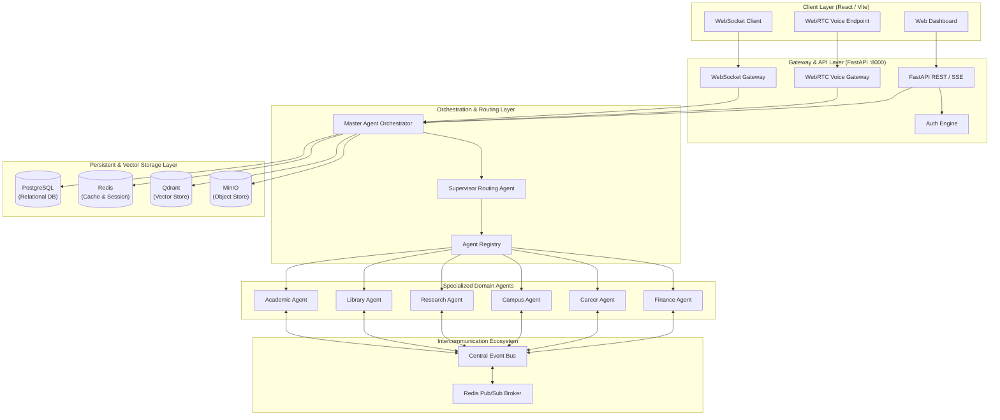
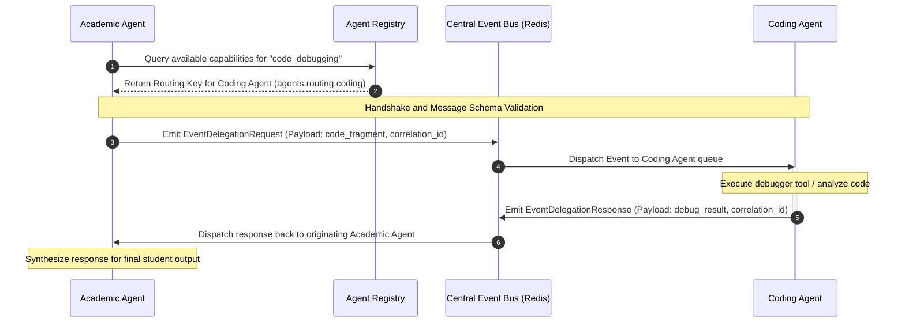
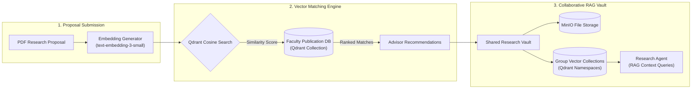

# Daffodil Intelligence (DI) — Project Documentation
*Professional & Formal Technical Specifications and Architectural Design*

---

## 1. Executive Summary
**Daffodil Intelligence (DI)** is a 360° Multi-Agent Artificial Intelligence Operating System designed for academic institutions, specifically tailored for university students, faculty members, and administrative staff. By transitioning from a basic reactive virtual assistant to a proactive multi-agent orchestration platform, Daffodil Intelligence integrates academic databases, campus transportation, research directories, real-time voice endpoints (WebRTC), and Model Context Protocol (MCP) tool bindings.

This documentation serves as the comprehensive source of truth for the Daffodil Intelligence architecture, covering its frontend web interface, reactive routing engine, agent pool, and external service gateways. Furthermore, it details the formal design specifications for two core platform extensions:
1. **The Intercommunication Ecosystem (Agent-to-Agent Event Bus)**
2. **The Research Community Hub**

---

## 2. System Architecture & Component Topology
Daffodil Intelligence employs a decoupled, multi-tier system architecture designed for high availability, low-latency agent routing, and secure vector search capabilities.



### Component Details
1. **Frontend Web Dashboard (`apps/web`)**: Implemented in React, Vite, MUI (Material-UI), and Zustand. It operates a real-time conversation screen, dynamic agent-status feeds, and live voice call integrations.
2. **Backend API Gateway (`apps/api`)**: Built on FastAPI. Serves as the central router for HTTP, Server-Sent Events (SSE), and WebSocket traffic. It manages connection sessions and authenticates requests via JWT tokens.
3. **Orchestrator Engine (`apps/api/app/runtime`)**: Uses a dual routing strategy:
   - *Supervisor Routing*: Uses semantic classification and keyword analysis to distribute incoming user messages to dedicated, specialized agents.
   - *LangGraph Workflows*: Models multi-step, parallel agent execution paths as directed acyclic graphs (DAGs).
4. **Tool Registry & MCP Server (`packages/mcp`)**: FastMCP-compliant server that exposes domain tools to agents, offering rate-limiting, permissions, and result validation.
5. **Data Store Layer**:
   - **PostgreSQL**: Stores persistent relational entities (Users, Credentials, Chat History, Agent Configurations).
   - **Redis**: Serves as a high-performance memory cache, WebSocket pub/sub engine, and Celery task broker.
   - **Qdrant**: Manages vector-embeddings for semantic RAG search.
   - **MinIO**: Handles object storage for PDFs, images, and audio attachments.

---

## 3. Core Subfeature: Intercommunication Ecosystem
The **Intercommunication Ecosystem** introduces a decentralized, event-driven agent-to-agent (A2A) networking mesh. It allows independent agents to discover, negotiate, and delegate sub-tasks dynamically without manual supervisor intervention.



### 3.1 Architecture Specifications
- **Central Event Broker**: Driven by Redis Pub/Sub channels. Sub-queues are established for each specialized agent class using patterns such as `di.agents.<agent_name>.inbound` and `di.agents.<agent_name>.outbound`.
- **Agent Registry**: Active agents register their status (`active`, `busy`, `ready`), supported tools, and semantic capability schemas to Redis with a 60-second TTL heartbeat. This metadata is parsed dynamically during routing decisions.
- **Dynamic Event Routing**: When an agent detects a query component it cannot handle (e.g., the Academic Agent parsing a request that demands code writing), it publishes a message containing a standard routing header to target appropriate secondary agents.

### 3.2 Protocol & Schema Definition
To prevent type-drift, all inter-agent communication must conform to the **CloudEvents v1.0.2** specifications wrapped in a custom JSON schema:

```json
{
  "$schema": "http://json-schema.org/draft-07/schema#",
  "title": "AgentIntercomEvent",
  "type": "object",
  "properties": {
    "id": { "type": "string", "format": "uuid" },
    "source": { "type": "string", "example": "di.agents.academic" },
    "type": { "type": "string", "example": "di.events.delegation.request" },
    "specversion": { "type": "string", "const": "1.0.2" },
    "time": { "type": "string", "format": "date-time" },
    "correlation_id": { "type": "string", "format": "uuid" },
    "session_id": { "type": "integer" },
    "destination": { "type": "string", "example": "di.agents.coding" },
    "data": {
      "type": "object",
      "properties": {
        "required_action": { "type": "string" },
        "payload": { "type": "object" },
        "timeout_ms": { "type": "integer", "default": 5000 }
      },
      "required": ["required_action", "payload"]
    }
  },
  "required": ["id", "source", "type", "specversion", "time", "correlation_id", "session_id", "destination", "data"]
}
```

---

## 4. Core Subfeature: Research Community Platform
The **Research Community Platform** bridges academic research, student initiatives, and thesis supervisions into a collaborative network powered by vector matching and semantic RAG vaults.



### 4.1 Advisor Matchmaking System
This system addresses a common university friction point: matching graduate and undergraduate students with prospective thesis advisors.
- **Data Ingestion**: Faculty publication records (abstracts, journal articles, active projects) are automatically scraped and synchronized using the University HR/Library APIs.
- **Embedding & Storage**: Document records are processed using `text-embedding-3-small` and saved in a dedicated `faculty_publications` collection in Qdrant.
- **Matching Pipeline**: When a student submits a thesis draft or proposal abstract, DI computes its vector representation, executes a cosine similarity search against `faculty_publications`, and returns the top 3 faculty profiles with detailed matching scores, publication citations, and research overlap highlights.

### 4.2 Shared Knowledge Vaults (RAG)
Designed for research groups, thesis circles, and laboratory courses:
- **Joint Reading Vaults**: Research groups can instantiate shared folders via the frontend. Documents uploaded to these folders are persisted in MinIO bucket locations unique to that group.
- **Dynamic Ingestion Pipeline**: Worker nodes chunk the documents and write embeddings to a collection in Qdrant namespace-isolated for the group: `group_<group_id>_vault`.
- **Collaborative RAG queries**: Group members query the collective knowledge vault. The `Research Agent` retrieves matching vectors strictly from the namespace-isolated index, preventing cross-group data leakage.

### 4.3 Thesis Progress & Automated Milestones Tracker
Automates thesis management workflows:
- **Milestone Management**: Tracks student progress across typical academic milestones: *Proposal Submission, Mid-term Evaluation, Manuscript Draft, Final Defense*.
- **Automatic Compliance Checks**: Integrates citation validation routines verifying manuscript references against standard guidelines (APA, MLA, IEEE) using external bibliographic endpoints.
- **Notification Routing**: When milestone status shifts, updates are sent dynamically over the *Intercommunication Ecosystem* to the `Notification Agent`, which dispatches notifications to students and faculty through WebSockets, Telegram channels, or WhatsApp.

---

## 5. Agent Ecosystem & Catalog
Daffodil Intelligence orchestrates 18 specialized domain agents:

| # | Agent Class | System Identifier | Core Capabilities |
|---|-------------|-------------------|-------------------|
| 1 | **Supervisor Agent** | `supervisor` | Orchestration, intent classification, multi-agent dispatch, response synthesis. |
| 2 | **Academic Agent** | `academic` | CGPA calculation, course registration advice, syllabus reviews, semester GPA audits. |
| 3 | **Library Agent** | `library` | Book searches, electronic resources retrieval, physical book seat reservations. |
| 4 | **Campus Services Agent** | `campus` | Room booking management, campus announcements routing, facilities statuses. |
| 5 | **Career Advisor Agent** | `career` | Internship tracking, resume parsing & scoring, career roadmaps creation. |
| 6 | **Coding Agent** | `coding` | Code generation, syntactic debugging, technical interview training. |
| 7 | **Research Agent** | `research` | Literature discovery, citation styling, abstract reviews, thesis brainstorming. |
| 8 | **Wellness Agent** | `wellness` | Student stress management protocols, cognitive guidelines, academic study habits. |
| 9 | **Finance Agent** | `finance` | Fee structure auditing, scholarship waiver analysis, installment calendar tracking. |
| 10 | **Vision Agent** | `vision` | Document OCR, user interface screenshots parsing, charts/graphs interpretations. |
| 11 | **Voice Agent** | `voice` | WebRTC audio synthesis, voice message translation, transcription pipeline. |
| 12 | **Exam Agent** | `exam` | Midterm/Final schedules audit, seat planning locations, attendance tracking. |
| 13 | **Hostel Agent** | `hostel` | Residence hall checks, service requests, room vacancy management. |
| 14 | **Transport Agent** | `transport` | University shuttle tracking, route timelines, special event transport bookings. |
| 15 | **Event Agent** | `event` | Club activity coordination, workshop notifications, campus calendars. |
| 16 | **Complaint Agent** | `complaint` | Student grievance collection, ticket queue management, support escalation. |
| 17 | **Notification Agent** | `notification`| Multi-channel notifications routing (Telegram, email, WebSocket alerts). |
| 18 | **Fee Agent** | `fee_agent` | Tuition statement audit, billing disputes, waivers verification. |

---

## 6. Database Schema Design (Core Entities)
Below is the PostgreSQL schema defining users, session records, academic tracking, and research vaults.

```sql
-- Core User Schema
CREATE TABLE users (
    id SERIAL PRIMARY KEY,
    email VARCHAR(255) UNIQUE NOT NULL,
    hashed_password VARCHAR(255) NOT NULL,
    full_name VARCHAR(255) NOT NULL,
    student_id VARCHAR(50) UNIQUE,
    department VARCHAR(100),
    current_semester INT,
    role VARCHAR(20) DEFAULT 'student' CHECK (role IN ('student', 'faculty', 'admin')),
    created_at TIMESTAMP WITH TIME ZONE DEFAULT CURRENT_TIMESTAMP
);

-- Academic Profiles
CREATE TABLE student_academic_profiles (
    id SERIAL PRIMARY KEY,
    user_id INT REFERENCES users(id) ON DELETE CASCADE,
    cgpa NUMERIC(3, 2) NOT NULL,
    completed_credits INT NOT NULL,
    probation_status BOOLEAN DEFAULT FALSE,
    updated_at TIMESTAMP WITH TIME ZONE DEFAULT CURRENT_TIMESTAMP
);

-- Research Communities
CREATE TABLE research_groups (
    id SERIAL PRIMARY KEY,
    name VARCHAR(255) NOT NULL,
    topic VARCHAR(255),
    created_by INT REFERENCES users(id),
    created_at TIMESTAMP WITH TIME ZONE DEFAULT CURRENT_TIMESTAMP
);

-- Research Group Memberships
CREATE TABLE research_group_members (
    group_id INT REFERENCES research_groups(id) ON DELETE CASCADE,
    user_id INT REFERENCES users(id) ON DELETE CASCADE,
    role VARCHAR(50) DEFAULT 'member' CHECK (role IN ('lead', 'member', 'advisor')),
    PRIMARY KEY (group_id, user_id)
);

-- Collaborative Knowledge Vault Files
CREATE TABLE knowledge_vault_documents (
    id SERIAL PRIMARY KEY,
    group_id INT REFERENCES research_groups(id) ON DELETE CASCADE,
    uploaded_by INT REFERENCES users(id),
    file_name VARCHAR(255) NOT NULL,
    minio_object_key VARCHAR(512) NOT NULL,
    qdrant_collection_name VARCHAR(255) NOT NULL,
    uploaded_at TIMESTAMP WITH TIME ZONE DEFAULT CURRENT_TIMESTAMP
);

-- Thesis Progress Tracking
CREATE TABLE thesis_milestones (
    id SERIAL PRIMARY KEY,
    student_id INT REFERENCES users(id) ON DELETE CASCADE,
    advisor_id INT REFERENCES users(id) ON DELETE SET NULL,
    title VARCHAR(512) NOT NULL,
    abstract TEXT,
    milestone_stage VARCHAR(50) DEFAULT 'proposal' CHECK (milestone_stage IN ('proposal', 'midterm', 'draft', 'defense_prep', 'completed')),
    citation_standard VARCHAR(20) DEFAULT 'APA',
    compliance_score INT,
    updated_at TIMESTAMP WITH TIME ZONE DEFAULT CURRENT_TIMESTAMP
);
```

---

## 7. API Routing & Endpoints
The backend exposes RESTful routers alongside real-time channels:

### 7.1 Authentication (`/api/auth`)
- `POST /register`: Registers student/faculty profiles.
- `POST /login`: Validates password and generates JWT.
- `POST /refresh`: Issues a replacement token using a refresh token.
- `GET /google`, `/microsoft`, `/github`: Third-party identity hooks.

### 7.2 Orchestrated Chats (`/api/agents`)
- `POST /chat`: Simple request-response interaction routing through the Supervisor.
- `POST /chat/stream`: Stream responses token-by-token (Server-Sent Events).
- `POST /tools/execute`: Executes registered tools directly.
- `POST /vision/analyze`: Ingests base64/binary screenshot feeds for UI element localization.

### 7.3 Real-time & WebSocket Routes (`/ws/{user_id}`)
- Establishes a persistent socket stream routing instant messages, system notifications, and agent activity heartbeats.

---

## 8. Development & Installation Guide

### Prerequisites
- Python 3.11+
- Node.js 18+ (pnpm package manager)
- Docker & Docker Compose

### Step 1: Infrastructure Initialization
Clone the repository, configure the environment, and spin up the local backing services:
```bash
# Copy settings templates
cp .env.example .env
cp apps/api/.env.example apps/api/.env

# Spin up Postgres, Redis, MinIO, and Qdrant
docker compose up -d
```

### Step 2: Database Initialization & Migrations
Ensure the database contains the correct schemas and tables:
```bash
cd apps/api
../../.venv/bin/alembic upgrade head
../../.venv/bin/python scripts/archive/migrate_json_to_postgres.py
```

### Step 3: Run the Application Core
You can run the full ecosystem in development mode or launch components individually:
```bash
# From workspace root
pnpm install
pnpm dev

# Or start services separately
pnpm docker:infra # Backing resources
pnpm dev:api      # FastAPI port :8000
pnpm dev:web      # React Dev port :3000
```
